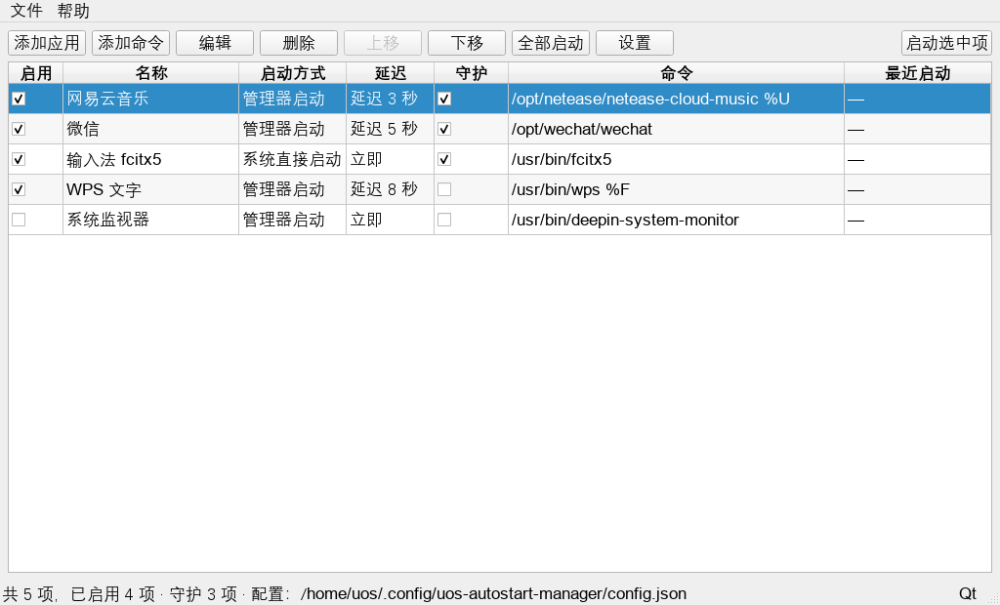

# 统信 UOS 开机自启动管理器

一款面向统信 UOS（以及 Debian 系 Linux 桌面）的开机自启动管理工具：从已安装应用中选择、
或自定义任意命令，设置启动顺序与延迟，并让管理器自身随开机启动、常驻系统托盘。

- 应用标识：`uos-autostart-manager`
- 当前版本：`1.1.0`
- 许可证：GPL-3+（见文末「许可证」）

---

## 1. 功能特性

- **从已安装应用中挑选**：自动扫描 XDG 应用目录（`/usr/share/applications`、
  `/usr/local/share/applications`、`~/.local/share/applications` 等）中的 `.desktop`
  条目，按名称排序后供勾选。
- **自定义命令**：可添加任意程序，支持参数、工作目录、图标、备注。
- **延迟启动**：每条目可设置 0–600 秒延迟；还可设置「全部启动前等待」的全局延迟。
- **启动顺序**：列表中的顺序即启动顺序，可用「上移 / 下移」调整。
- **掉线自动重启（守护）**：可对任意条目勾选「守护」，管理器默认**每 20 分钟**检测一次，
  发现该应用没在运行时自动重新启动；检测间隔可在设置中修改（1–1440 分钟），
  也可随时在「文件 → 立即检测掉线应用」手动检查一次。
- **两种启动方式**：
  - 「管理器启动」：由本管理器在开机时按顺序拉起，支持延迟，可在界面中立即启动；
  - 「系统直接启动」：由桌面环境通过 XDG 自启动机制直接拉起（写入用户级
    `~/.config/autostart/`），即使管理器未运行也能生效。
- **管理器自身开机自启**：可开关，默认随开机以 `--tray` 方式驻留托盘。
- **托盘常驻**：托盘菜单提供「显示主窗口 / 立即启动全部应用 / 打开配置目录 / 退出」；
  关闭主窗口时默认最小化到托盘（可在设置中修改）。
- **图形界面 + 命令行**：图形界面优先使用 PyQt5，缺失时自动降级为 tkinter；
  无图形环境也可用 `--list`、`--start-all`、`--doctor` 等命令。
- **安全可靠**：配置原子写入、损坏配置自动备份；启动外部程序不经过 shell；
  日志按 1 MB 滚动保留 2 份。
- **多用户友好**：每个用户拥有独立配置；管理器自启状态可按用户单独覆盖。

---

## 2. 界面预览



主窗口由工具栏、条目表格与状态栏组成：

- 工具栏：`添加应用`、`添加命令`、`编辑`、`删除`、`上移`、`下移`、`全部启动`、`设置`，右侧为 `启动选中项`；
- 表格列：`启用`（勾选框）、`名称`、`启动方式`、`延迟`、`守护`（勾选框）、`命令`、`最近启动`；
- 状态栏：`共 N 项，已启用 M 项 · 守护 K 项 · 配置：<配置文件路径>`，右下角显示当前界面后端（Qt / Tk）。

```
┌──────────────────────────────────────────────────────────────────────────────────┐
│ [添加应用] [添加命令] [编辑] [删除] [上移] [下移] [全部启动] [设置]                │
├──────┬────────────────┬──────────────┬──────────┬──────┬─────────────────────────┤
│ 启用 │ 名称           │ 启动方式     │ 延迟     │ 守护 │ 命令                    │
├──────┼────────────────┼──────────────┼──────────┼──────┼─────────────────────────┤
│  ☑   │ 网易云音乐     │ 管理器启动   │ 延迟 5 秒│  ☑   │ /usr/bin/netease-cloud  │
│  ☑   │ 输入法         │ 系统直接启动 │ 立即     │  ☑   │ /usr/bin/fcitx5         │
└──────┴────────────────┴──────────────┴──────────┴──────┴─────────────────────────┘
状态栏：共 2 项，已启用 2 项 · 守护 2 项 · 配置：/home/user/.config/uos-autostart-manager/config.json
```

---

## 3. 系统要求

| 项目 | 要求 |
| --- | --- |
| 操作系统 | 统信 UOS 20 及以上；其他 Debian 系 Linux（Debian 10+、Ubuntu 20.04+ 等） |
| Python | Python 3.7 及以上（UOS 20 自带 3.7.5） |
| 图形界面 | 推荐 `python3-pyqt5`；缺失时自动使用 `python3-tk`（tkinter） |
| 桌面环境 | 支持 XDG 自启动规范（DDE / UKUI / GNOME / KDE / Xfce 等均可） |
| 架构 | `Architecture: all`，x86_64 / arm64 / loongarch 等均适用 |
| 权限 | 日常使用**不需要** root；仅安装、卸载需要管理员权限 |

---

## 4. 安装

### 4.1 使用 .deb 安装包（推荐）

安装包发布路径为 `dist/uos-autostart-manager_1.1.0_all.deb`。在仓库根目录执行：

```bash
sudo dpkg -i dist/uos-autostart-manager_1.1.0_all.deb
```

如果提示缺少依赖（例如未安装 PyQt5 / tkinter），执行：

```bash
sudo apt install -f
```

也可以直接让 `apt` 处理依赖并安装：

```bash
sudo apt install ./dist/uos-autostart-manager_1.1.0_all.deb
```

安装完成后：

```bash
uos-autostart-manager --version     # 应输出：统信 UOS 开机自启动管理器 1.1.0
uos-autostart-manager --doctor      # 查看运行环境诊断
```

应用菜单中会出现「统信 UOS 开机自启动管理器」，图标名为 `uos-autostart-manager`。
如果菜单没有刷新，可手动执行：

```bash
sudo update-desktop-database /usr/share/applications
```

安装包会同时写入系统级自启动文件
`/etc/xdg/autostart/uos-autostart-manager.desktop`，登录桌面后管理器会自动以托盘方式启动。

### 4.2 从源码树便携安装（不使用 dpkg）

适合没有打包环境、或想安装到自定义前缀的场景：

```bash
chmod +x scripts/install.sh                  # 若脚本没有执行权限，先加一次
sudo ./scripts/install.sh                    # 默认前缀 /usr
sudo ./scripts/install.sh --prefix /usr/local
sudo ./scripts/install.sh --uninstall        # 卸载
```

脚本会检查源码树完整性，然后安装启动器、Python 包、桌面入口、自启动项与图标，
并刷新桌面/图标缓存。安装到用户目录（无需 root）时可这样用：

```bash
UOS_AM_AUTOSTART_DIR="$HOME/.config/autostart" \
  ./scripts/install.sh --prefix "$HOME/.local"
```

> 卸载时请使用与安装时相同的 `--prefix`（以及可选的 `UOS_AM_AUTOSTART_DIR`）。

---

## 5. 卸载与升级

### 5.1 卸载

```bash
# 卸载程序，保留用户配置（推荐，便于以后重装恢复）
sudo dpkg -r uos-autostart-manager

# 彻底移除软件包（用户配置与日志仍会保留，见下方说明）
sudo dpkg -P uos-autostart-manager

# 使用 apt 卸载
sudo apt remove uos-autostart-manager
```

用户配置 `~/.config/uos-autostart-manager/` 与日志 `~/.local/share/uos-autostart-manager/`
属于用户数据，即使 `purge` 也不会被自动删除。如需彻底清除：

```bash
rm -rf ~/.config/uos-autostart-manager
rm -rf ~/.local/share/uos-autostart-manager
rm -f  ~/.config/autostart/uos-am-*.desktop
rm -f  ~/.config/autostart/uos-autostart-manager.desktop
```

使用 `scripts/install.sh` 安装的，可用 `sudo ./scripts/install.sh --uninstall` 卸载系统文件。

### 5.2 升级

从新版本 `.deb` 直接覆盖安装即可自动升级（不会丢失用户配置）：

```bash
sudo dpkg -i dist/uos-autostart-manager_<新版本>_all.deb
sudo apt install -f          # 如有依赖变化
```

若软件包来自 APT 仓库，也可使用 `sudo apt update && sudo apt upgrade`。

---

## 6. 使用教程

### 6.1 启动程序

- 应用菜单：搜索「统信 UOS 开机自启动管理器」；
- 命令行：`uos-autostart-manager`（打开图形界面）；
- 托盘模式：`uos-autostart-manager --tray`（开机自启时使用，启动托管应用后驻留托盘）；
- 首次运行：列表为空时会提示「点击「添加应用」从已安装程序中选择」，不会自动添加任何条目。

### 6.2 添加已安装应用

1. 点击工具栏「**添加应用**」；
2. 在弹出的应用列表中可用搜索框过滤，也可勾选「仅显示可执行」缩小范围；
3. 选中目标应用后，名称、命令、图标、备注会自动填入条目表单；
4. 按需修改「启动延迟」「启动方式」等字段，点击保存。

条目会出现在主列表中，勾选「启用」后立即生效。

### 6.3 添加自定义命令

1. 点击工具栏「**添加命令**」；
2. 填写表单：
   - `名称`（必填）：显示在列表中的名字；
   - `命令`（必填）：完整程序路径，例如 `/usr/bin/firefox`；可点击「浏览」选择文件；
   - `参数`（可选）：追加在命令之后，例如 `--no-remote`；
   - `工作目录`（可选）：程序运行目录；
   - `图标`（可选）：图标名或绝对路径；
   - `启动延迟`：0–600 秒；
   - `启动方式`：管理器启动 / 系统直接启动；
   - `在终端中运行`：需要终端窗口的程序可勾选；
   - `备注`（可选）。
3. 保存前会校验名称与命令，未通过会在弹窗中提示中文错误原因。

> 注意：程序以“程序 + 参数”数组方式直接启动，**不经过 shell**。因此命令中不能使用
> 管道 `|`、通配符 `*`、`&&`、重定向 `>` 等 shell 语法。需要复杂逻辑时，请先写一个
> 可执行脚本，再在命令处填写解释器调用，例如 `/bin/sh /home/user/bin/start-my-app.sh`。

### 6.4 设置延迟与启动顺序

- **单条延迟**：编辑条目，把「启动延迟」设为 0–600 秒。延迟 5 秒即表示启动开始后等待 5 秒再拉起。
  - 「管理器启动」方式：由管理器在后台线程中按顺序 `sleep` 后启动；
  - 「系统直接启动」方式：延迟写入 `.desktop` 的 `X-GNOME-Autostart-Delay`，由桌面环境解释。
- **全局延迟**：「设置」中的「全部启动前等待（秒）」会在线程开始时先等待，再按列表顺序启动。
- **启动顺序**：表格中每条目的上下位置就是启动顺序，用「上移」「下移」调整。
  由于每项延迟是累加的，把依赖项排在前、并给后续项设置合适的延迟，就能控制先后。

### 6.5 两种启动方式的区别

| 对比项 | 管理器启动（manager） | 系统直接启动（xdg） |
| --- | --- | --- |
| 谁来拉起程序 | 本管理器（`--tray` / `--start-all`） | 桌面环境（XDG autostart） |
| 是否需要管理器自身开机自启 | 需要 | 不需要 |
| 延迟实现 | 管理器线程内按顺序等待 | 写入 `X-GNOME-Autostart-Delay`，由桌面环境处理 |
| 生成的文件 | 无（保存在配置文件里） | `~/.config/autostart/uos-am-<条目ID>.desktop` |
| 适用场景 | 需要严格顺序、统一管理、日志记录 | 希望桌面环境原生接管、管理器不常驻也能启动 |

切换方式后，管理器会在下次同步时自动创建或清理对应的 `.desktop` 文件。

### 6.6 托盘菜单

开机自启（`--tray`）后，管理器驻留系统托盘，右键菜单包含：

- **显示主窗口**：恢复主界面（双击托盘图标同样有效）；
- **立即启动全部应用**：按当前顺序与延迟立即拉起所有启用项；
- **打开配置目录**：在文件管理器中打开 `~/.config/uos-autostart-manager/`；
- **退出**：退出管理器（不会删除已配置的条目）。

若当前桌面环境没有系统托盘，程序会自动降级为普通窗口，功能不受影响。

### 6.7 设置项

点击工具栏「**设置**」，可修改：

- **管理器开机自启动**：开启/关闭本管理器自身的开机自启（立即生效）；
- **开机时最小化到托盘**：开机自启后是否直接隐藏主窗口；
- **关闭窗口时最小化到托盘**：关闭主窗口时隐藏到托盘而不是退出（关闭后可从托盘恢复）；
- **全部启动前等待（秒）**：全局延迟，0–600 秒；
- **掉线自动重启（全局开关）**：暂停/恢复所有条目的掉线检测；各条目自身的「守护」勾选会保留；
- **检测间隔（分钟）**：默认 **20**，可设 1–1440 分钟；
- **打开配置目录**：快速定位配置文件。

### 6.8 启用 / 禁用与其他操作

- 勾选或取消表格中的「启用」复选框会立即保存并同步 `.desktop` 文件；
- 勾选或取消表格中的「守护」复选框会立即保存该条目的掉线自动重启设置；
- 双击某行可编辑；选中行后可「删除」「上移」「下移」；
- 「全部启动」会立即按顺序启动所有启用条目（不改变开机行为）；
- 「文件 → 立即检测掉线应用」可随时手动执行一轮检测，结果显示在状态栏；
- 状态栏显示「共 N 项，已启用 M 项 · 守护 K 项 · 配置：<配置文件路径>」，右下角显示当前界面后端（Qt / Tk）。

### 6.9 掉线自动重启（守护）

适合需要长期驻留的应用（输入法、通讯软件、监控客户端、壁纸/桌面组件等）：

1. 在条目行的「守护」列打勾（或在「添加/编辑」对话框勾选「掉线自动重启」）；
2. 在「设置」中确认「启用掉线自动重启（全局开关）」已勾选，并按需调整检测间隔（默认 20 分钟）；
3. 之后管理器会在后台线程中按间隔检查：若该应用**未在运行**，自动重新启动它，并写入日志；
4. 不想被自动拉起时，取消该条目的「守护」勾选即可（关闭应用后不会再被重启）。

说明：

- 检测依据是进程命令行：绝对路径命令匹配完整路径，相对命令匹配进程名；会跳过管理器自身；
- 守护线程随管理器一起运行（`--tray` 开机自启场景下自动生效），退出管理器即停止守护；
- 每轮检查都会重新读取配置，修改勾选或间隔后无需重启管理器；
- 也可用 `--watch-once` 手动执行一轮检测，或用 `--watch` 在前台运行守护（便于排查）。

---

## 7. 命令行用法

```text
uos-autostart-manager                    打开图形界面
uos-autostart-manager --tray             托盘模式（开机自启使用），启动托管应用后驻留托盘
uos-autostart-manager --start-all        无界面启动全部启用项（含 xdg 模式）
uos-autostart-manager --list             文本列出配置项
uos-autostart-manager --doctor           输出环境诊断
uos-autostart-manager --version          显示版本
uos-autostart-manager --watch            前台运行掉线守护（Ctrl+C 退出）
uos-autostart-manager --watch-once       只执行一轮掉线检测并输出结果
uos-autostart-manager --watch-interval N 守护检查间隔（秒，调试用，默认按设置中的分钟数）
uos-autostart-manager --no-watchdog      本次运行不启动后台守护
uos-autostart-manager --config PATH      指定配置文件（测试用）
uos-autostart-manager --no-sync          跳过 xdg 桌面文件的同步
uos-autostart-manager --dry-run          只打印将要启动什么，不真正执行
```

常用示例：

```bash
uos-autostart-manager --list              # 查看现有条目
uos-autostart-manager --doctor            # 排查环境/自启问题
uos-autostart-manager --start-all         # 手动触发一次“开机启动”
uos-autostart-manager --start-all --dry-run   # 预演，不实际启动
uos-autostart-manager --watch-once        # 立即检查一次是否有应用掉线
uos-autostart-manager --watch --watch-interval 60   # 前台守护，每 60 秒检查一次（调试）
```

---

## 8. 配置文件与日志

| 用途 | 路径 |
| --- | --- |
| 主配置文件 | `~/.config/uos-autostart-manager/config.json`（遵循 `XDG_CONFIG_HOME`） |
| 每条「系统直接启动」条目的自启动文件 | `~/.config/autostart/uos-am-<条目ID>.desktop` |
| 管理器自身自启的用户级覆盖文件 | `~/.config/autostart/uos-autostart-manager.desktop` |
| 系统级自启动文件（随包安装） | `/etc/xdg/autostart/uos-autostart-manager.desktop` |
| 日志 | `~/.local/share/uos-autostart-manager/logs/manager.log`（遵循 `XDG_DATA_HOME`，1 MB × 2 滚动） |
| 单实例锁等运行状态 | `~/.local/share/uos-autostart-manager/state/` |
| 损坏配置备份 | `config.json.corrupt.<时间戳>`（自动改名，不会直接丢失） |

配置文件格式示例：

```json
{
  "version": 1,
  "manager_autostart": true,
  "start_minimized": false,
  "close_to_tray": true,
  "global_delay": 0,
  "watchdog_enabled": true,
  "watchdog_interval_minutes": 20,
  "items": [
    {
      "id": "a1b2c3d4e5f6",
      "name": "网易云音乐",
      "command": "/usr/bin/netease-cloud-music",
      "workdir": "",
      "icon": "netease-cloud-music",
      "comment": "",
      "enabled": true,
      "watchdog": true,
      "delay": 5,
      "mode": "manager",
      "terminal": false,
      "created_at": "2026-10-24T20:40:34",
      "last_run_at": "",
      "run_count": 0
    }
  ]
}
```

说明：

- `mode` 为 `manager`（管理器启动）或 `xdg`（系统直接启动）；
- `delay` 与 `global_delay` 取值范围均为 0–600；
- `watchdog` 为该条目的「掉线自动重启」开关；
- `watchdog_enabled` 为全局守护开关，`watchdog_interval_minutes` 为检测间隔（1–1440 分钟，默认 20）；
- 管理器自启开关的实现：关闭时写入用户级覆盖文件并在其中设置 `Hidden=true`，
  从而压过系统级 `/etc/xdg/autostart/` 条目；开启时写回 `Hidden=false`。
- 配置文件由程序原子写入（先写临时文件再替换），请勿在程序运行时手工编辑；
  若 JSON 损坏，程序会自动把坏文件改名为 `config.json.corrupt.<时间戳>` 并恢复默认配置。

---

## 9. 常见问题（FAQ）

### 9.1 开机后自启动没有生效

1. 先运行诊断：

   ```bash
   uos-autostart-manager --doctor
   ```

   它会检查管理器自启状态、每条命令是否可执行、xdg 条目文件是否存在且启用。

2. 确认「管理器开机自启动」处于开启状态（设置对话框），且
   `/etc/xdg/autostart/uos-autostart-manager.desktop` 与
   `~/.config/autostart/uos-autostart-manager.desktop` 的 `Hidden` 值符合预期。

3. 确认条目本身已勾选「启用」，且启动方式与预期一致：
   - 「管理器启动」需要管理器随开机运行；
   - 「系统直接启动」需要桌面环境支持 XDG autostart，并检查
     `~/.config/autostart/uos-am-*.desktop` 是否存在、`X-GNOME-Autostart-enabled=true`。

4. 查看日志 `~/.local/share/uos-autostart-manager/logs/manager.log`，
   常见原因是命令路径写错、程序依赖缺失或权限不足。

5. 若设置了延迟，请耐心等待（单条延迟 + 全局延迟会累加）；「系统直接启动」方式下延迟由
   桌面环境处理，不同环境对 `X-GNOME-Autostart-Delay` 的支持程度可能不同。

6. 部分精简桌面环境可能不执行 `/etc/xdg/autostart`，可改用「管理器启动」方式：
   确保会话启动时运行一次 `uos-autostart-manager --tray`。

### 9.2 提示没有 PyQt5 / 界面没有出现

- 安装 PyQt5（推荐）：

  ```bash
  sudo apt install python3-pyqt5
  ```

- 或安装 tkinter 兜底：

  ```bash
  sudo apt install python3-tk
  ```

- 两者都没有时，图形界面无法打开，但命令行功能仍可用：
  `uos-autostart-manager --list`、`--start-all`、`--doctor`。
- UOS 上若 Python 版本与系统包不匹配，请确认 `python3 --version` 为 3.7 及以上，
  并使用系统自带的 `python3`（不要混用自行编译的 Python 环境）。

### 9.3 没有系统托盘 / 托盘图标不显示

- 程序会检测系统托盘是否可用（`QSystemTrayIcon.isSystemTrayAvailable()`）；
  不可用时自动降级为普通窗口，不影响自启功能。
- 某些桌面环境需要额外安装托盘扩展（例如 GNOME 需 AppIndicator 扩展）。
- 托盘异常时可尝试重启桌面会话，或直接运行 `uos-autostart-manager` 打开主窗口操作。

### 9.4 Wayland 会话

- 程序会把 `DISPLAY`、`WAYLAND_DISPLAY`、`XAUTHORITY` 等环境变量原样传递给被启动的程序。
- 被托管的应用由自身决定使用 Wayland 还是 XWayland，本程序不做干预。
- 若 Qt 界面在 Wayland 下无法启动，可尝试强制使用 X11 后端：

  ```bash
  QT_QPA_PLATFORM=xcb uos-autostart-manager
  ```

- Wayland 下托盘支持取决于具体桌面环境与版本；没有托盘时会自动降级为普通窗口。
- XDG autostart 文件由桌面环境读取，在 Wayland 会话中同样有效。

### 9.5 多用户使用

- 系统级 `/etc/xdg/autostart/uos-autostart-manager.desktop` 对**所有用户**生效；
- 每个用户的配置相互独立（各自的 `~/.config/uos-autostart-manager/config.json`），
  互不影响；
- 如果只想让某个用户不启动管理器，在该用户下打开设置关闭「管理器开机自启动」即可，
  程序会写入该用户自己的 `~/.config/autostart/` 覆盖文件（`Hidden=true`），
  不会影响其他用户；
- 卸载软件包不会删除任何用户的配置与日志。

### 9.6 应用菜单里找不到程序

```bash
sudo update-desktop-database /usr/share/applications
gtk-update-icon-cache -q -t -f /usr/share/icons/hicolor || true
```

然后重新登录桌面，或在菜单中搜索「统信 UOS 开机自启动管理器」。

### 9.7 双击 .deb 打开的是压缩包管理器

部分文件管理器会把 `.deb` 关联到压缩包查看器。可以直接用命令安装：

```bash
sudo apt install ./uos-autostart-manager_1.1.0_all.deb
```

或在右键菜单中选择「用 deb 安装器打开」；也可以先运行 `sudo dpkg -i <deb>`，
再执行 `sudo apt install -f` 补齐依赖。

### 9.8 重复启动时会怎样

程序带单实例保护：管理器（GUI / 托盘）只允许运行一个实例。开机自启后再从菜单点击图标时，
第二个进程会提示「已有实例在运行」并退出，不会重复拉起被托管的应用。
`--list`、`--doctor`、`--start-all`、`--watch-once` 等命令行子命令不受此限制，可随时单独执行。

### 9.9 关闭应用后又被自动拉起来了

说明该条目勾选了「守护」（掉线自动重启）。这是预期行为：管理器会在每个检测间隔
（默认 20 分钟）发现它没有运行就重新启动。解决办法：

- 取消该条目的「守护」勾选；或
- 在「设置」中关闭「启用掉线自动重启（全局开关）」；或
- 临时用 `uos-autostart-manager --watch-once` 观察一轮结果，确认是哪个条目被重启。

如果希望某个应用只在开机时启动一次、之后关闭就保持关闭，请**不要**勾选守护。

### 9.10 守护似乎没有重启应用

1. 确认该条目已勾选「启用」**和**「守护」，且设置里全局开关为开启；
2. 运行 `uos-autostart-manager --doctor` 查看「掉线守护」一行（是否启用、间隔、守护条目数）；
3. 手动执行一次 `uos-autostart-manager --watch-once`，看输出是「运行中」还是「重新启动」；
4. 若一直显示「运行中」但你认为程序已退出，通常是程序名与探测规则不匹配
   （例如命令写的是包装脚本，而实际进程名不同）：把「命令」改为真实的程序路径，
   或在命令中带上能被识别的可执行文件名；
5. 查看日志 `~/.local/share/uos-autostart-manager/logs/manager.log` 中的「守护：」记录。

---

## 10. 从源码运行（开发调试）

无需安装，直接从源码树运行：

```bash
cd uos-autostart-manager
PYTHONPATH=src python3 -m uos_autostart            # 打开图形界面
PYTHONPATH=src python3 -m uos_autostart --list     # 文本列出条目
PYTHONPATH=src python3 -m uos_autostart --doctor   # 环境诊断
PYTHONPATH=src python3 -m uos_autostart --dry-run  # 预演启动
```

也可以先进入 `src/` 目录：

```bash
cd uos-autostart-manager/src
python3 -m uos_autostart
```

运行单元测试（测试全部使用临时目录，不会写用户真实配置）：

```bash
cd uos-autostart-manager
python3 -m unittest tests.test_core tests.test_watchdog -v
```

安装了 PyQt5 时优先使用 Qt 界面，否则使用 tkinter；两者都没有时只能使用命令行模式。

---

## 11. 自行构建 .deb 安装包

构建脚本使用**纯 Python 标准库**（`ar` + `tar.gz`），不依赖 `dpkg-deb`，
因此在 Windows 上也能构建。

```bash
cd uos-autostart-manager
python3 tools/build_deb.py
```

产物：

```text
dist/uos-autostart-manager_1.1.0_all.deb
```

说明：

- 版本号唯一来源是仓库根目录的 `VERSION` 文件，`packaging/control` 中的
  `{{VERSION}}` / `{{INSTALLED_SIZE}}` 占位符由构建脚本替换；
- 构建脚本读取 `src/uos_autostart/*.py`、`packaging/`、`assets/`、`README.md`；
- 构建完成后可校验安装包结构（可选）：

  ```bash
  python3 tools/verify_deb.py                 # 结构自检
  python3 -m unittest tests.test_package -v   # 安装包校验测试
  ```

  `tests.test_package` 直接解析 `dist/*.deb` 的 ar 归档，检查成员顺序、control 元数据、
  data 布局与权限、Python 源码可解析性、md5sums 一致性等；`dist/` 下没有 `.deb` 时自动跳过。

---

## 12. 安装包结构

`.deb` 内 `data.tar.gz` 的安装布局（权限精确）：

```text
./usr/bin/uos-autostart-manager                                     0755
./usr/lib/uos-autostart-manager/uos_autostart/*.py                  0644
./usr/share/applications/uos-autostart-manager.desktop              0644
./etc/xdg/autostart/uos-autostart-manager.desktop                   0644
./usr/share/icons/hicolor/scalable/apps/uos-autostart-manager.svg   0644
./usr/share/icons/hicolor/{16x16,24x24,32x32,48x48,64x64,128x128,256x256}/apps/uos-autostart-manager.png
                                                                    0644
./usr/share/doc/uos-autostart-manager/README.md                     0644
./usr/share/doc/uos-autostart-manager/copyright                     0644
./usr/share/doc/uos-autostart-manager/changelog.gz                  0644
```

`control.tar.gz` 中包含 `control`、`md5sums`、`conffiles` 以及维护脚本
`postinst` / `prerm` / `postrm`；其中 `/etc/xdg/autostart/uos-autostart-manager.desktop`
被标记为 conffile（卸载时保留用户对自启动项的本地修改）。
`/usr/bin/uos-autostart-manager` 是一个轻量启动器：调用系统 `#!/usr/bin/python3`，
把 `/usr/lib/uos-autostart-manager` 加入 `sys.path` 后执行 `uos_autostart.app.main()`。

---

## 13. 许可证

本项目以 **GNU General Public License v3 或更高版本（GPL-3+）** 发布。

- 许可证全文（Debian 系统）：`/usr/share/common-licenses/GPL-3`
- 版权与打包信息：安装后见 `/usr/share/doc/uos-autostart-manager/copyright`
- 项目主页（占位）：<https://example.com/uos-autostart-manager>

Copyright (C) 2026 UOS Autostart Manager Contributors

本程序是自由软件：您可以自由地重新分发和/或修改它，但需遵守自由软件基金会发布的
GNU 通用公共许可证（第 3 版或您选择的任何更高版本）的条款。本程序分发时希望其有用，
但不提供任何担保，甚至不提供适销性或特定用途适用性的默示担保。
